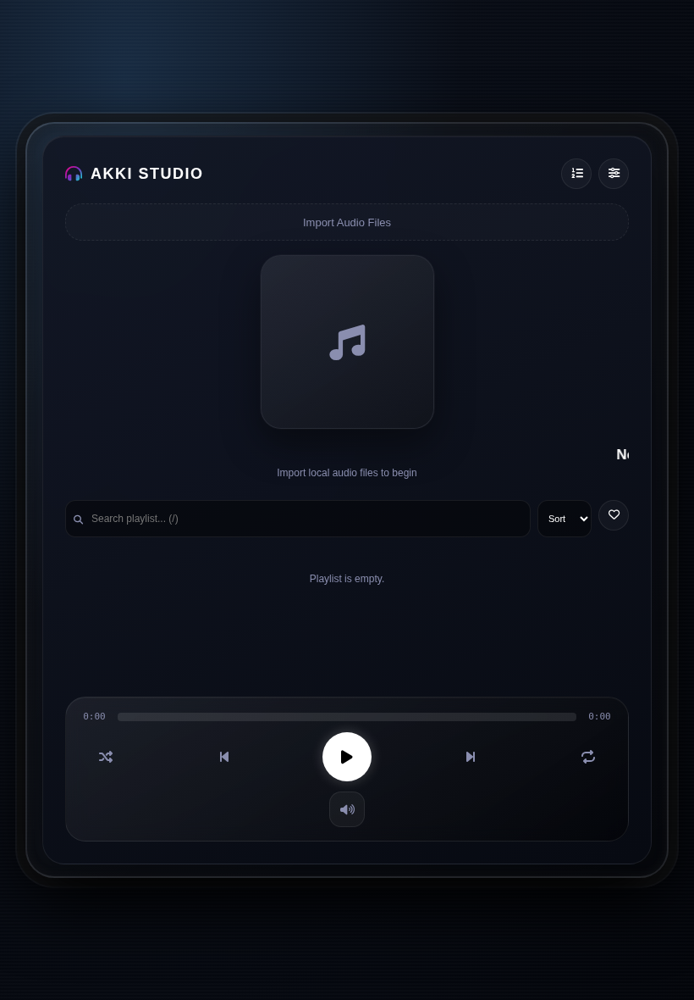

# AKKI MUSIC — Pro Studio Edition 2.0

A local-first browser music player with a polished studio interface, personal audio library, playback tools, EQ presets, visualizers, and optional binaural spatial processing.

<p align="center">
  
</p>

<p align="center">
  
</p>

<p align="center">
  
</p>

## Live demo

**[Open AKKI MUSIC on GitHub Pages](https://akki-9605.github.io/Music-app-v2/)**

## Features

- **Local audio library:** Import multiple audio files from your device using the file picker or drag and drop.
- **Track metadata and artwork:** Read supported embedded tags and display album artwork.
- **Playback controls:** Play, pause, skip, seek, mute, and adjust output level with keyboard shortcuts.
- **Queue and shuffle:** Add tracks to Up Next, shuffle playback, and switch repeat modes.
- **Favorites, search, and sorting:** Save favorites, filter the playlist, search track details, and sort by title or artist.
- **Studio EQ:** Flat, Bass Boost, Vocal, Pop, and Rock presets.
- **Binaural 3D spatial mode:** Uses the Web Audio API HRTF panner, a slower spatial orbit, and a subtle stereo room-reflection tail. Best experienced with stereo headphones.
- **Live visualizers:** Frequency bars, waveform, pulse, and particle modes.
- **Personalization:** Accent color, Dark Glass / AMOLED themes, vinyl artwork mode, and playback speed.
- **Responsive layouts:** Desktop, iPad/tablet, and iPhone layouts with touch-friendly controls and iOS safe-area spacing.

### Audio and Apple-device notes

The on-screen volume slider has been removed because browser volume sliders are not consistently supported by iOS Safari. The player now uses a mute button; keyboard Up/Down adjusts the Web Audio output level after playback has initialized. The operating system's physical volume buttons remain the primary volume control on iPhone and iPad.

Binaural spatial processing is a headphone-oriented effect, not a replacement for a true multichannel or head-tracked spatial-audio system. Results vary by headphones, browser, and audio source. On iOS, start playback with the player controls to allow Safari to initialize audio processing.

## Run locally

No build step or backend is required.

1. Clone the repository:
   ```bash
   git clone https://github.com/AKKI-9605/Music-app-v2.git
   cd Music-app-v2
   ```
2. Start a local static server:
   ```bash
   python3 -m http.server 8000
   ```
3. Open [http://localhost:8000](http://localhost:8000).
4. Import audio files from your device.

## Keyboard shortcuts

| Shortcut | Action |
| --- | --- |
| Space | Play / pause |
| Left / Right | Seek backward / forward 5 seconds |
| Up / Down | Adjust Web Audio output level |
| M | Mute / unmute |
| N / P | Next / previous track |
| Q | Toggle Up Next queue |
| F | Toggle favorites filter |
| / | Focus playlist search |
| Escape | Close settings / leave search |

## Tests

Playwright browser tests cover the desktop player, settings, mute behavior, 3D spatial mode, keyboard search, iPhone layout, and iPad layout. The test run captures desktop, iPad, and mobile screenshots used above.

Install dependencies and Chromium:

```bash
npm install
npx playwright install chromium
```

Run:

```bash
npm test
```

## Deployment

GitHub Actions runs the browser tests on pushes to `main`. On successful runs it refreshes the README screenshots and deploys the static app to GitHub Pages.

**Live site:** https://akki-9605.github.io/Music-app-v2/

## Built with

- HTML5, CSS3, and vanilla JavaScript
- Web Audio API (HRTF PannerNode, ConvolverNode, GainNode, AnalyserNode)
- Canvas API
- [jsmediatags](https://github.com/aadsm/jsmediatags)
- [Font Awesome](https://fontawesome.com/)
- [Playwright](https://playwright.dev/)

## Privacy

Playback is client-side. The app does not include an account system, music catalog, streaming service, or app backend. Imported audio files are handled in the browser and are not uploaded to an app server. External CDN resources are used for the metadata and icon libraries.
