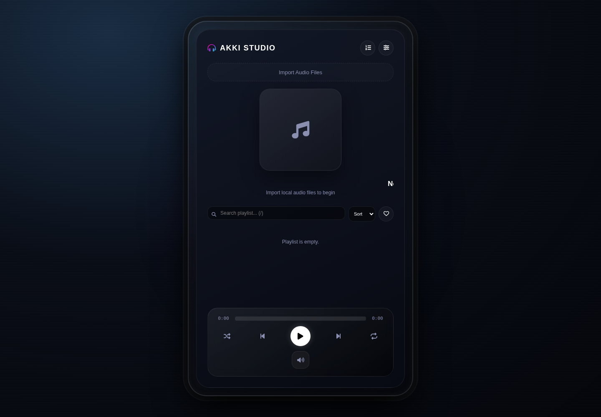
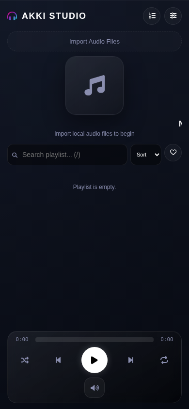

# AKKI MUSIC — Pro Studio Edition 2.0

A local-first music player that turns your browser into a personal listening studio. Import audio files from your device, organize your listening queue, and shape playback with studio-style audio effects — without uploading your music to a server.

<p align="center">
  
</p>

<p align="center">
  
</p>

## Live demo

**[Open AKKI MUSIC on GitHub Pages](https://akki-9605.github.io/Music-app-v2/)**

The app runs in your browser. Your audio files are selected locally and are not uploaded to an app backend.

## Features

- **Local audio library:** Import multiple audio files using the file picker or drag and drop.
- **Track metadata and artwork:** Read supported embedded tags and display album artwork with the track.
- **Playback controls:** Play, pause, skip, seek, adjust volume, and control playback speed.
- **Queue and shuffle:** Add tracks to an Up Next queue, shuffle playback, and switch repeat modes.
- **Favorites, search, and sorting:** Save favorite tracks, filter the playlist, search by track details, and sort by title or artist.
- **Studio EQ:** Choose Flat, Bass Boost, Vocal, Pop, or Rock presets.
- **16D spatial audio:** Optional HRTF panning and synthetic reverb using the Web Audio API.
- **Live visualizers:** Frequency bars, waveform, pulse, and particle modes.
- **Personalization:** Accent color, dark/AMOLED theme, vinyl artwork mode, and saved playback preferences.

## Run locally

No build step or backend is required.

1. Clone the repository:
   ```bash
   git clone https://github.com/AKKI-9605/Music-app-v2.git
   cd Music-app-v2
   ```
2. Start a local static server:
   ```bash
   python3 -m http.server 8000
   ```
3. Open [http://localhost:8000](http://localhost:8000).
4. Import audio files from your device.

You can also open `index.html` directly, although a local server is recommended for consistent browser behavior.

## Keyboard shortcuts

| Shortcut | Action |
| --- | --- |
| Space | Play / pause |
| Left / Right | Seek backward / forward 5 seconds |
| Up / Down | Adjust volume |
| M | Mute / unmute |
| N / P | Next / previous track |
| Q | Toggle Up Next queue |
| F | Toggle favorites filter |
| / | Focus playlist search |
| Escape | Close settings / leave search |

## Tests

The project uses Playwright browser tests to check the initial player interface, settings interactions, keyboard search shortcut, and mobile layout. The test run also captures desktop and mobile screenshots used above.

Install dependencies and the Chromium browser:

```bash
npm install
npx playwright install chromium
```

Run the tests:

```bash
npm test
```

## Deployment

The GitHub Actions workflow in `.github/workflows/ci-pages.yml` runs the browser tests on pushes to `main`. On successful runs it refreshes the README screenshots and deploys the app to GitHub Pages.

Live site: **https://akki-9605.github.io/Music-app-v2/**

## Built with

- HTML5, CSS3, and vanilla JavaScript
- Web Audio API
- Canvas API
- [jsmediatags](https://github.com/aadsm/jsmediatags) for supported audio metadata
- [Font Awesome](https://fontawesome.com/) for interface icons
- Playwright for browser testing

## Privacy

Playback is client-side. The app does not include an account system, music catalog, streaming service, or app backend. Imported audio files are handled in the browser; metadata and preferences are processed locally. External CDN resources are used for the metadata and icon libraries.
